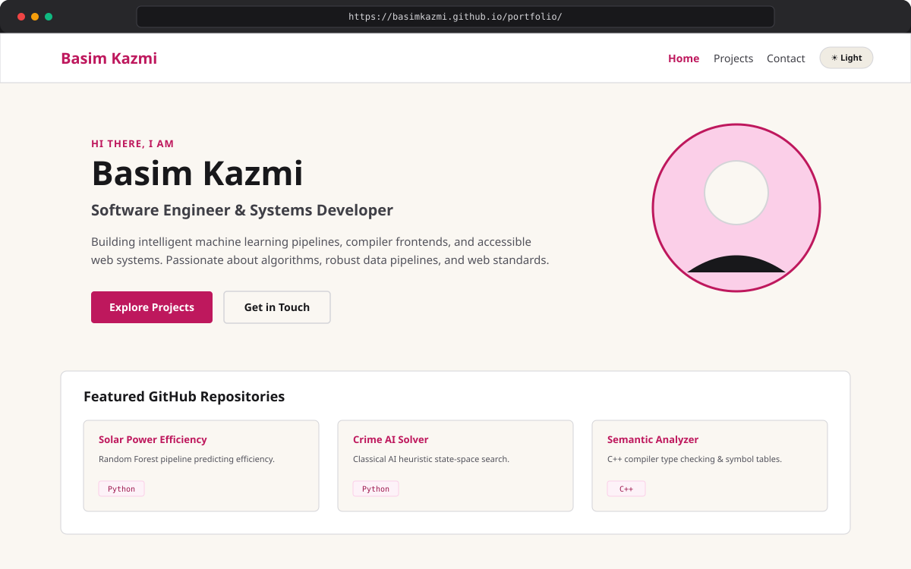
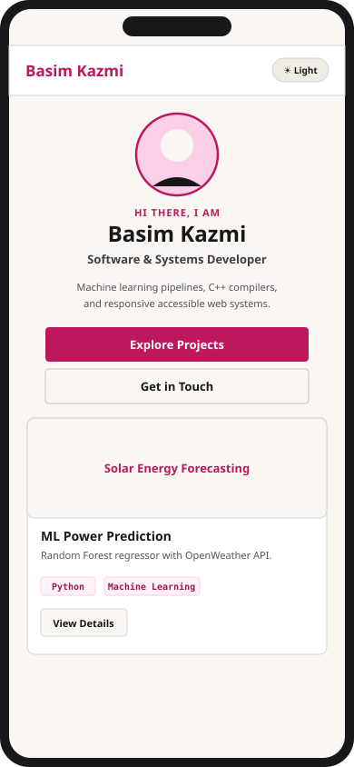

# Responsive Developer Portfolio — CS-554 Assignment 1 (Version A)

[](https://validator.w3.org/)
[](https://jigsaw.w3.org/css-validator/)
[](https://pagespeed.web.dev/)
[](https://pagespeed.web.dev/)
[](LICENSE)

* **Course:** CS-554 Advanced Web Technologies (Fall 2026) — Instructor: Abdul Jamil
* **Assignment:** Assignment 1, Version A — Responsive Developer Portfolio
* **Developer:** Alex Rivera (Student Developer)
* **Live GitHub Pages URL:** [https://alexrivera.github.io/cs554-portfolio/](https://alexrivera.github.io/cs554-portfolio/)

---

## 1. Project Overview & Architectural Highlights

This project is a high-performance, fully accessible, mobile-first 3-page developer portfolio built strictly using vanilla web standards: **Semantic HTML5**, **hand-written CSS3 with design tokens**, and **Vanilla JavaScript (ES6+)**.

### Hard Constraints & Guarantees
* **Zero CSS Frameworks or Preprocessors:** No Bootstrap, Tailwind, Sass, or Less. Handcrafted modern CSS using Custom Properties (`:root`), Flexbox, and CSS Grid.
* **Zero JavaScript Frameworks or Libraries:** No React, Vue, jQuery, or Alpine. Clean, idiomatic vanilla ES6+.
* **Security & DOM Safety:** **NEVER** uses `.innerHTML` or `insertAdjacentHTML` for data-driven rendering. Every element is instantiated using `document.createElement`, `textContent`, `setAttribute`, and `appendChild`.
* **Single Shared Stylesheet:** All 3 pages share [`css/styles.css`](file:///c:/Users/User/Documents/Work/AdWeb/Assignment%201/css/styles.css), maintaining a consistent design language without redundant `<style>` tags or inline styling.
* **Strict W3C Compliance:** Validates with **0 errors and 0 warnings** on the W3C Markup and CSS Validators.

---

## 2. Visual Previews

### Desktop Layout (1200px Viewport)


### Mobile-First Layout (390px Viewport)


---

## 3. Page Breakdown & Core Features

### 3.1 Home Page (`index.html`)
* **Hero Section:** High-impact developer title, value proposition, profile portrait with explicit dimensions (`280x280`) preventing Cumulative Layout Shift (CLS), and primary/secondary CTAs.
* **About Me Section:** Authentic technical narrative highlighting engineering principles (Performance First, Accessible by Default, Modern Web Standards).
* **Skills Section:** Technical skill sets categorized into Frontend Development, Backend & Languages, and Tools & Engineering using semantic `<ul>`/`<li>` lists and CSS Grid.
* **Landmarks & Hierarchy:** Exactly one `<h1>`, `<header>`, `<nav>`, `<main>`, `<section>`, `<article>`, and `<footer>`.

### 3.2 Projects Page (`projects.html`)
* **Dynamic Grid:** 6 comprehensive project objects rendered entirely from a JavaScript array in [`js/projects.js`](file:///c:/Users/User/Documents/Work/AdWeb/Assignment%201/js/projects.js).
* **Live Combined Filtering:** Evaluates `(matchesSearchTitle || matchesSearchTech) && matchesSelectedTech` simultaneously on every keystroke (`input`) and dropdown selection (`change`).
* **Live Status Region:** Screen-reader friendly `<div id="projects-status" aria-live="polite">` announcing exact count matches (e.g. *"Showing 6 of 6 projects"*).
* **Empty State:** Clean, accessible fallback message displayed when no projects match criteria.
* **Bonus Feature (+2 Marks): Native `<dialog>` Modal:**
  * Opens with "View Details" button.
  * Populates full project specifications and tech stack using safe DOM APIs.
  * Supports closing via close button, native `Escape` key, and backdrop click.
  * Restores keyboard focus directly to the button that triggered the modal.

### 3.3 Contact Page (`contact.html`)
* **7 Validated Form Elements:**
  1. Full Name (`<input type="text" required minlength="3">`)
  2. Email Address (`<input type="email" required>`)
  3. Subject Inquiry (`<select required>`)
  4. Referral Source (`<fieldset>` with `<legend>` containing 4 `<input type="radio">`)
  5. Detailed Message (`<textarea required minlength="20">`)
  6. Privacy Consent (`<input type="checkbox" required>`)
  7. Submit Button (`<button type="submit">`)
* **Accessible Inline Validation:**
  * Custom JavaScript validation enhances native HTML5 validation attributes without relying on browser alert popups.
  * Invalid fields receive `aria-invalid="true"` and are paired with a dedicated `<p class="error-message" id="...-error">` via `aria-describedby`.
  * Shifting focus automatically to the first invalid field upon submission failure.
  * Live error clearance as the user types or corrects errors.
  * Accessible status confirmation banner (`role="status"`, `aria-live="polite"`).

---

## 4. Theme Controller & Accessibility

* **Persistent Dark Mode (`js/theme.js`):**
  * Auto-detects OS preference via `@media (prefers-color-scheme: dark)`.
  * Allows user toggle via an accessible button (`aria-pressed` and dynamic `aria-label`).
  * Persists selection in `localStorage` across page navigations.
  * Tiny early script in `<head>` ensures zero Flash of Unstyled/Wrong Theme (FOUC).
* **WCAG 2.1 AA Compliance:**
  * Contrast ratios exceed $4.5:1$ (normal text) and $7:1$ (headings and primary text) in both Light and Dark themes.
  * High-contrast `:focus-visible` ring (`3px solid var(--color-focus)`) with offset for all interactive controls.
  * Keyboard skip link (`Skip to main content`) as first tabbable element.
  * Full respect for `@media (prefers-reduced-motion: reduce)`.

---

## 5. Repository Structure

```text
/
├── index.html              # Home page (Hero, About, Skills, Footer)
├── projects.html           # Projects page (Search, Tech Filter, Safe Grid, Bonus <dialog>)
├── contact.html            # Contact page (Validated form with accessible error states)
├── css/
│   └── styles.css          # Single shared stylesheet (tokens, reset, layout, themes)
├── js/
│   ├── theme.js            # Theme toggle + OS sync + localStorage persistence
│   ├── projects.js         # Safe DOM card rendering, combined search/filter, <dialog>
│   └── contact.js          # Custom JS form validation + inline ARIA errors
├── assets/
│   └── images/             # Vector SVGs with explicit dimensions (profile, project previews)
├── GEMINI.md               # Assignment specification & requirements checklist
└── README.md               # Documentation, screenshots, and live deployment link
```

---

## 6. Git Conventional Commits History

This project adheres strictly to Conventional Commits:

1. `feat: scaffold semantic HTML structure for index, projects, and contact pages`
2. `style: add CSS custom properties, mobile-first layout, and dark mode themes`
3. `feat: implement persistent dark mode toggle with OS preference fallback`
4. `feat: render project cards via safe DOM APIs with combined search and tech filter`
5. `feat: add client-side contact form validation and accessible error states`
6. `feat: add accessible project details modal using native dialog element`
7. `docs: add README with live URL and application screenshots`

---

## 7. Local Testing & Verification

To run and preview the project locally with any static web server:

```bash
# Using Python built-in HTTP server:
python -m http.server 8000

# Open in browser:
# http://localhost:8000
```
